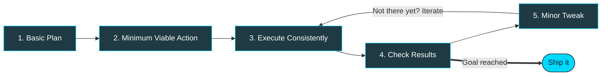

  

 

  

---

## 👋 Hey there, I'm Phaneeth

Undergraduate CS student at **MITS, Madanapalle**, aiming to get ridiculously good at tech.
Coming from a tier-3 college, I've learned to juggle academics and self-driven learning the hard way, and I wouldn't trade what it taught me.

> 💡 **My philosophy:** *Real-world execution shows the correct way as we go.*
> I don't wait for the perfect plan. I make a basic one, act on it, and iterate.

---

## 🔁 How I Work: Minimum Viable Actions

---

## 🔭 What I'm Up To

| | Focus | Status |
|:-:|---|:-:|
| 🧠 | **DSA in C++**: Done with Arrays, Strings & OOPS. Currently revising and solving Linked Lists | 🟢 Daily |
| 🌐 | **Node.js & web projects**: Carbon Trigger browser extension (Webpack, REST APIs) | 🟡 In progress |
| 🌱 | **Open source**: Getting ready for my first contributions | 🟡 Preparing |
| 🤝 | **Internships & collaborations**: Actively looking | 🔎 Open to Opportunities |

---

## 🛠️ Tech Stack & Tools

  

---

## 🤝 Let's Connect

**I'd love to hear from techies.**

  

*"Small actions, repeated daily, beat big plans never started."*

